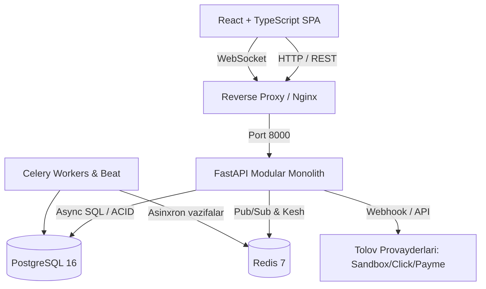

# AuctionHub Arxitekturasi

## 1. Umumiy Ko‘rinish
AuctionHub arxitekturasi **Modular Monolith** tamoyiliga asoslangan. Ushbu yondashuv mikroxizmatlarning murakkab operatsion xarajatlarisiz domenlararo toza ajratish (separation of concerns), yuqori unumdorlik va qulay rivojlanish imkonini beradi.

## 2. Asosiy Qatlamlar (Layered Structure)
Har bir biznes domen moduli (masalan, `auctions`, `bidding`, `payments`) qat'iy ravishda quyidagi qatlamlarga bo'linadi:

1. **Router (`router.py`)**: Faqat HTTP/WS so'rovlarni qabul qilish, parametrlarni validatsiya qilish va status kodlarini qaytarish.
2. **Service (`service.py`)**: Asosiy biznes mantiq, hisob-kitoblar, tekshiruvlar va tranzaksiyalarni boshqarish.
3. **Repository (`repository.py`)**: Ma'lumotlar bazasi bilan to'g'ridan-to'g'ri ishlash (SQLAlchemy queries).
4. **Models (`models.py`)**: SQLAlchemy ORM ma'lumotlar modeli.
5. **Schemas (`schemas.py`)**: Pydantic DTO (Data Transfer Objects) va so'rov/javob validatsiyasi.
6. **Dependencies (`dependencies.py`)**: Foydalanuvchi huquqlari (RBAC) va xizmat injeksiyasi.

## 3. Real-Time Komponenti
Auksion savdolari va narx oshish jarayoni past kechikishli (low latency) WebSocket orqali uzatiladi.
- WebSocket ulanishi autentifikatsiya qilinadi.
- Auksion xonasi (`auction_id`) bo'yicha hodisalar tarqatiladi.
- Redis Pub/Sub gorizontal miqyoslashda bir nechta FastAPI instansiyalari o'rtasida hodisalarni sinxronlaydi.

