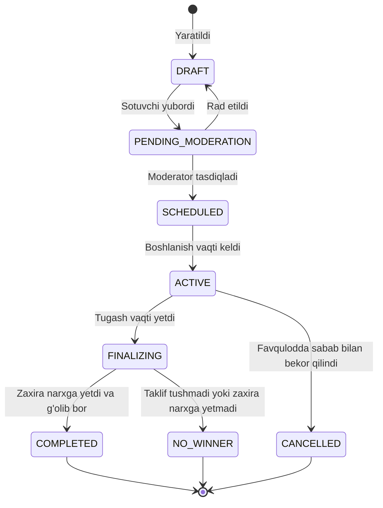

# Auksion Hayot Sikli (Auction Lifecycle)

## Bosqichlar:
1. **DRAFT & MODERATION**: Sotuvchi barcha ma'lumotlarni to'ldiradi. Moderator qoidalarga muvofiqligini tekshiradi.
2. **SCHEDULED**: Boshlanish sanasi kutiladi. Foydalanuvchilar auksionni ko'rishi va oldindan depozit to'lashi mumkin.
3. **ACTIVE**: Savdo ochiq. Tasdiqlangan depozitga ega foydalanuvchilar real-vaqtda takliflar beradi. Oxirgi daqiqalarda taklif tushsa, auksion avtomatik ravishda 5 daqiqaga uzaytiriladi (anti-sniping).
4. **FINALIZING**: Auksion yopiladi. Yangi takliflar qabul qilinmaydi. Tizim eng yuqori taklif va zaxira narxni tekshiradi.
5. **COMPLETED / NO_WINNER**: G'olib aniqlansa, unga to'lov muddati (3 kun) belgilanadi. Boshqa ishtirokchilarning depozitlari avtomatik qaytarish navbatiga qo'yiladi.

