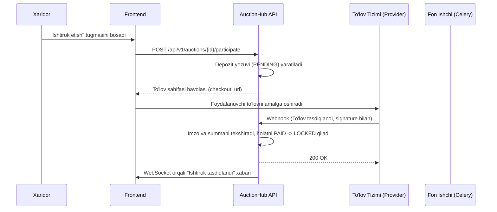

# To'lov va Escrow Oqimi (Payment Flow)

## 1. Depozit To'lash

## 2. Yutqazganlarga Depozit Qaytarish (Refunds)
1. Auksion `COMPLETED` yoki `NO_WINNER` bo'lganda, barcha no-winning ishtirokchilar `REFUND_PENDING` holatiga o'tkaziladi.
2. Celery vazifasi to'lov provayderining qaytarish API'si orqali summani orqaga qaytaradi.
3. Provayder tasdiqlagach holat `REFUNDED` deb belgilanadi va xaridordan xabar yuboriladi.
4. Idempotency kalitlari orqali bir xil depozit ikki marta qaytarilishidan to'liq himoyalangan.

